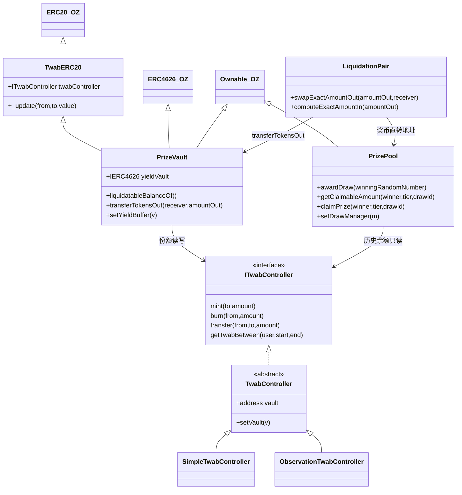
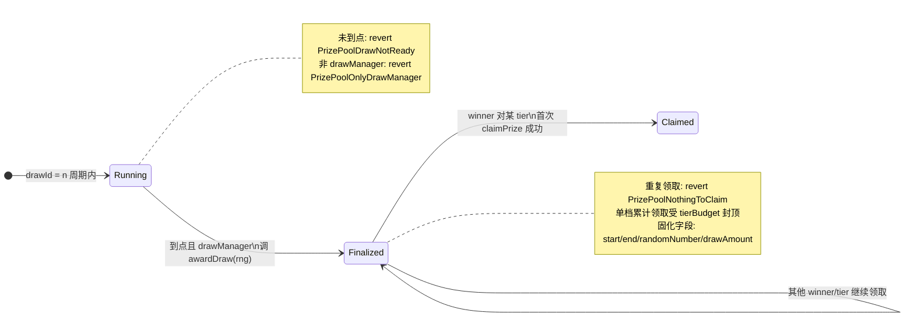

# 合约架构

> 本篇覆盖核心合约的职责划分、依赖关系、开奖状态机、全局不变量与权限边界。接口签名以代码为准（[contracts/src/interfaces/](../../contracts/src/interfaces/)），本篇不复制。

## 合约清单

| 合约 | 文件 | 职责 |
|------|------|------|
| `PrizeVault` | [PrizeVault/PrizeVault.sol](../../contracts/src/PrizeVault/PrizeVault.sol) | ERC-4626 金库：存取款、资产投入底层收益源、暴露可清算 yield；份额余额全部委托 TWAB |
| `TwabERC20` | [PrizeVault/TwabERC20.sol](../../contracts/src/PrizeVault/TwabERC20.sol) | 份额代币抽象：`balanceOf/totalSupply/_update` 全部路由到 TwabController |
| `PrizePool` | [PrizePool/PrizePool.sol](../../contracts/src/PrizePool/PrizePool.sol) | 每日开奖、3 档奖金、按 TWAB 抽样判定、预算封顶的主动领取 |
| `SimpleTwabController` | [TwabController/SimpleTwabController.sol](../../contracts/src/TwabController/SimpleTwabController.sol) | TWAB 实现 A：追加式 checkpoint + 线性扫描，M0 默认 |
| `ObservationTwabController` | [TwabController/ObservationTwabController.sol](../../contracts/src/TwabController/ObservationTwabController.sol) | TWAB 实现 B：2^16 环形缓冲 + 二分，生产取向 |
| `LiquidationPair` | [LiquidationPair/LiquidationPair.sol](../../contracts/src/LiquidationPair/LiquidationPair.sol) | 周期内线性降价拍卖：奖币买走 yield，奖币直转入奖池；成交抛 `Liquidation(sender,receiver,amountIn,amountOut)`（钳制后实际值） |
| `MockERC20` / `MockERC4626` | [mocks/](../../contracts/src/mocks/) | 本地资产与收益源（捐赠抬价模拟计息），不上生产 |

## 依赖与继承

图注：`PrizePool` 与 `PrizeVault` 只依赖 `ITwabController` 接口，不感知 TWAB 具体实现；`LiquidationPair` 与 `PrizePool` 之间没有合约调用，仅靠"奖币转到 Pool 地址 + Pool 按余额增量记账"解耦。

## 开奖状态机

时间边界全部由构造期固定的 `drawPeriodOffset + drawPeriodSeconds` 推导（见 `drawStart/drawEnd/nextDrawStart`），开奖后写入的 mapping 不可变——这是"TWAB 只读追溯"的存储基础。

## 中奖判定算法（为什么这样抽样）

EVM 无法在一次交易内对全体用户做无放回抽样，`getClaimableAmount` 采用**期望份额 + 余数抽签**（[PrizePool.sol#L139-L154](../../contracts/src/PrizePool/PrizePool.sol)）：

1. `slots = floor(userTwab × count / totalTwab)`——用户在该档确定获得的份数，严格随 TWAB 线性增长。
2. 余数 `remainder` 用 `keccak256(winner, drawId, tier, winningRandomNumber) % totalTwab < remainder` 做一次伪随机判定，决定是否再中一份。
3. 3 档硬编码（`pure` 函数，不可治理更改）：Grand 1 份×60%、次级 4 份×25%、Canary 100 份×15%。
4. **超发防护**：独立余数抽样的期望总和可能超过档预算，`claimPrize` 用 `_tierClaimed` 对单档累计领取额做 `tierBudget` 封顶——宁可少发不可超发，避免耗尽 `_reserve`。

奖金额在 `awardDraw` 时一次性快照：`drawAmount = 奖币余额 − _reserve`（已固化未领取的部分不重复计入）。

## 全局不变量与验证位置

| # | 不变量 | 代码保证 | 测试 |
|---|--------|----------|------|
| 1 | **零损失**：`totalAssets() >= totalSupply()` | 份额 1:1 恒等换算；收益只增加资产不铸造份额；可清算额 = 资产 −（供应 + yield buffer） | [Invariants.t.sol](../../contracts/test/Invariants.t.sol) 两个 fuzz、[PrizeVault.t.sol](../../contracts/test/PrizeVault.t.sol) `test_no_loss_invariant`、[Integration.t.sol](../../contracts/test/Integration.t.sol) 终态 `assertGe` |
| 2 | **份额守恒**：`TwabController.totalSupply() == PrizeVault.totalSupply()` | 份额不独立存储，`TwabERC20._update` 是唯一写入口且仅 vault 经 ERC4626 mint/burn 触发 | Invariants 中 `assertEq` 双断言、[TwabControllerBehavior.t.sol](../../contracts/test/TwabControllerBehavior.t.sol) `test_only_vault_can_mutate` |
| 3 | **TWAB 只读追溯**：开奖后存取款不改变历史 draw 结果 | draw 固化 start/end/randomNumber；领取金额只由 `getTwabBetween(start,end)` 对历史区间计算，任何新余额变动只追加 checkpoint | TwabControllerBehavior `test_twab_time_weighted` / `test_getBalanceAt`、PrizePool `test_claim_then_cannot_reclaim`、两种 TWAB 实现各跑一遍的 Integration 闭环 |

## 权限与资金边界

| 角色 | 能做什么 | 不能做什么（安全红线） |
|------|----------|------------------------|
| PrizePool `owner` | `setDrawManager` | 接触不到奖币；无暂停/提款函数 |
| `drawManager`（keeper） | 注入随机数 `awardDraw` | 不能决定中奖者（随机数在 TWAB 抽样中只作种子）、不能动资金 |
| PrizeVault `owner` | `setLiquidationPair`、`setYieldBuffer` | 不能转移用户资产；不能改兑换率 |
| `liquidationPair` | 从金库转出**可清算 yield** | 转出量受 `liquidatableBalanceOf` 上钳（`swapExactAmountOut` 内 cap） |
| TwabController `vault` | mint/burn/transfer 份额 | `setVault` 交接后旧 vault 永久失权，无回退路径 |
| 任意地址 | `claimPrize(winner, …)` 代领 | 奖金只 `safeTransfer` 给 `winner` 本人 |

> 已知简化（M0）：随机数来源信任 `drawManager`，其作恶只能影响谁中奖、不能增发或挪用奖金；上线前需按 [ADR-0003](../decisions/ADR-0003-keeper-injected-rng-over-pfda.md) 接入可验证随机源。
