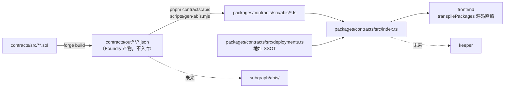
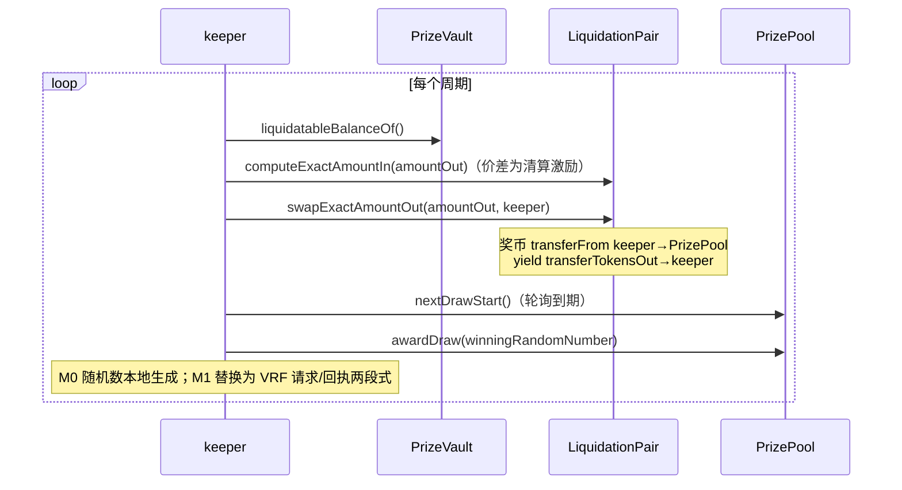

# 跨模块接口契约

> 本篇是最易漂移的粘合层：ABI/地址/事件如何从合约单向生成并被 frontend / keeper / subgraph 消费。改任何 ABI、事件、schema 必须在同 PR 内同步本篇。

## 1. ABI / 地址 / 类型生成链路

图注：上游只有 `contracts/` 一个事实源；TS 侧只允许消费 `@prize-savings/contracts` 的导出，禁止在业务代码内联手写 ABI。

**再生成（一条命令）**：仓库根执行 `pnpm contracts:abis`，会先 `forge build` 再运行 [scripts/gen-abis.mjs](../../scripts/gen-abis.mjs) 覆盖写出 4 个 ABI 文件；`erc20Abi` 是手写最小集不在生成范围内。生成器输出是确定性的（`JSON.stringify(abi, null, 2)`），接口未变时重跑不应产生 diff，可据此判断生成物是否漂移。

当前生成物（[packages/contracts/src/abis/](../../packages/contracts/src/abis/)）：

| 导出 | 来源 |
|------|------|
| `prizeVaultAbi` | `contracts/out/PrizeVault.sol/PrizeVault.json` |
| `prizePoolAbi` | `contracts/out/PrizePool.sol/PrizePool.json` |
| `twabControllerAbi` | `out/**/ITwabController.json`（接口 ABI） |
| `liquidationPairAbi` | `out/LiquidationPair.sol/LiquidationPair.json` |
| `erc20Abi` | 手写最小集（`approve/allowance/balanceOf/decimals/symbol`） |

**地址 SSOT**：[deployments.ts](../../packages/contracts/src/deployments.ts) 的 `DEPLOYMENTS[chainId]` 为缺省值，`getDeployment(chainId)` 允许 `NEXT_PUBLIC_*` 环境变量逐项覆盖（含正则校验）。31337 当前为零地址占位，本地部署后回填。

## 2. 事件 → subgraph 映射

subgraph 目前是**空脚手架**（[subgraph.yaml](../../subgraph/subgraph.yaml) `dataSources: []`、schema 只有占位注释）。下表是合约已抛出事件与目标实体的**契约约定**，供 subgraph 落地时直接遵循：

| 合约事件 | indexed 字段 | 目标实体（规划） | 用途 |
|----------|--------------|------------------|------|
| `PrizePool.DrawAwarded(drawId, winningRandomNumber, drawAmount)` | `drawId` | `Draw`（id=drawId，存随机数与奖池额） | 开奖列表、详情页 |
| `PrizePool.PrizeClaimed(drawId, tier, winner, amount)` | `drawId,tier,winner` | `PrizeClaim` + `Winner` 聚合 | 中奖记录、已领取状态 |
| `PrizePool.DrawManagerSet(drawManager)` | — | `ProtocolState`（单例） | 开奖者变更审计 |
| `LiquidationPair.Liquidation(sender, receiver, amountIn, amountOut)` | `sender,receiver` | `Liquidation`（清算流水：清算者、奖币入池额、yield 出金额） | 收益注入明细、清算者激励统计 |
| ERC-4626 `Deposit(caller,owner,assets,shares)` | `owner` | `Deposit` / `VaultAccount` 余额快照 | 存款流水 |
| ERC-4626 `Withdraw(caller,receiver,owner,assets,shares)` | `owner` | `Withdrawal` / 账户快照 | 赎回流水 |
| ERC-20 `Transfer`（pvUSDC 份额，经 TwabERC20 抛出） | `from,to` | 份额变动流水（可选） | TWAB 之外的链上明细 |

> `Liquidation` 事件携带的是**钳制后**的实际成交值：当请求 `amountOut` 超过 `liquidatableBalanceOf()` 时合约先上钳再成交，请求量与成交量不同时以事件值为准（测试见 `LiquidationPair.t.sol` 的两个 swap 用例）。无可清算 yield（`amountOut == 0`）时不成交也不抛事件。
>
> M0 前端的开奖/领取历史不依赖 subgraph，而用 viem `getContractEvents` 直读 `DrawAwarded/PrizeClaimed`（见 [use-draws.ts](../../frontend/src/hooks/use-draws.ts)），仅适用于 anvil/低区块量场景。

## 3. keeper ↔ 合约交互面

keeper 目前是 **no-op 脚手架**（[keeper/src/index.ts](../../keeper/src/index.ts)）。规划职责与调用面：

| 调用 | 权限要求 | 环境变量 |
|------|----------|----------|
| `LiquidationPair.swapExactAmountOut` | 需持有奖币并 `approve` pair；无私钥白名单（无许可清算） | `RPC_URL`、`PRIVATE_KEY` |
| `PrizePool.awardDraw` | msg.sender 必须等于 `drawManager` | 同上；部署后需 `setDrawManager(keeper)` 交接 |

keeper 不直接触碰 PrizeVault 的资金路径，只经由 `LiquidationPair` 的公开清算函数获取激励。

## 4. 前端消费约定

- 只读批量请求统一走 wagmi `useReadContracts`（multicall），写交易走 `useWriteContract` + `waitForTransactionReceipt`，hooks 清单见 [frontend/ARCHITECTURE.md](../../frontend/ARCHITECTURE.md)。
- viem 类型映射：`uint8/uint32 → number`、`uint256/address` 之外的动态类型按 viem 默认；所有 `uint256` 以 `bigint` 处理，UI 层经 [format.ts](../../frontend/src/lib/format.ts) 格式化。
- 链与地址：`chains = [foundry]`（31337），地址解析经 `useDeployment()`（env 覆盖 → `DEPLOYMENTS`），零地址占位时各查询 hook 整体 `enabled: false`。
