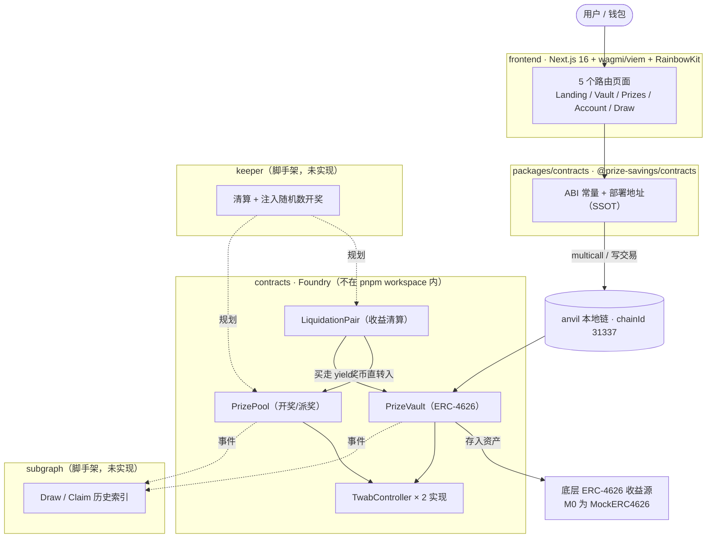
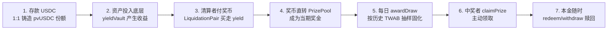

# 系统概览

Prize Savings 是一个**无损储蓄抽奖（No-Loss Lottery）**应用：用户本金可随时全额赎回，存款产生的收益被清算成奖币注入奖池，按时间加权平均余额（TWAB）每日随机开奖。产品与协议的冻结设计见 [../prd/prize-savings-lottery-design.md](../prd/prize-savings-lottery-design.md)，本篇只描述当前实现长成什么样、关键权衡是什么。

## 模块地图

图注：实线为 M0 已实现链路；虚线为 keeper / subgraph 尚待实现的规划链路。所有合约当前只部署在本地 anvil。

## 核心数据流（一期开奖的资金生命周期）

图注：本金始终 1:1 留在金库体系内；只有**超过本金 + yield buffer 的收益**可被清算（[`PrizeVault.liquidatableBalanceOf()`](../../contracts/src/PrizeVault/PrizeVault.sol)），这是"零损失"的资金边界。

## M0 实现状态

| 模块 | 状态 | 说明 |
|------|------|------|
| contracts | ✅ 闭环完成 | 存款 → 收益 → 清算 → 开奖 → 领奖 → 赎回，含 fuzz 不变量与端到端测试 |
| frontend | ✅ MVP 完成 | 5 路由、存/取/领奖、奖池与开奖历史（直接读链上事件） |
| packages/contracts | ✅ 可用 | ABI 常量 + 31337 地址占位，前端源码直编消费 |
| keeper | ⬜ 脚手架 | [keeper/src/index.ts](../../keeper/src/index.ts) 为 no-op，职责见 [module-contracts.md](./module-contracts.md) |
| subgraph | ⬜ 脚手架 | schema/dataSource 为空，前端暂用 `getContractEvents` 直读事件 |

## 关键架构权衡（M0）

1. **窄而深**：单链（anvil）、单资产 USDC、单一奖币，先验证公平性与闭环（[ADR-0004](../decisions/ADR-0004-single-asset-usdc.md)）。
2. **信任化开奖替代 PFDA**：随机数由白名单 `drawManager`（keeper）注入，不做 Chainlink VRF/PFDA 拍卖，砍掉最大复杂度（[ADR-0003](../decisions/ADR-0003-keeper-injected-rng-over-pfda.md)）。
3. **份额恒等映射**：`convertToShares/assets` 为 1:1，收益不摊回份额、以超额资产形式留存待清算，零损失证明退化为减法不等式。
4. **TWAB 双实现可插拔**：`SimpleTwabController`（追加 checkpoint/线性扫描，默认）与 `ObservationTwabController`（2^16 环形缓冲/二分）共用 `ITwabController`，部署时用 `TWAB_MODE` 切换。
5. **contracts 不进 workspace**：Foundry 工程无 Node 构建需求，ABI 通过共享 SDK 单向输出给 TS 模块（[ADR-0001](../decisions/ADR-0001-pnpm-monorepo-contracts-excluded.md)）。
