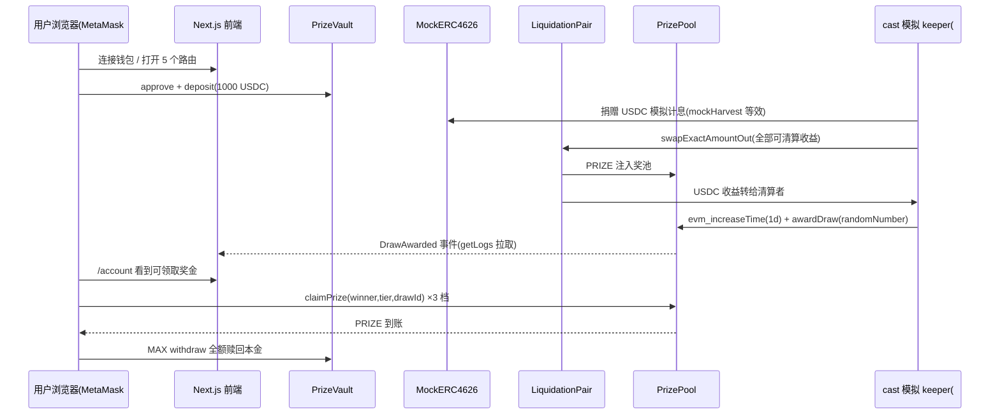

# 手工端到端联调手册（M0 · 本地 anvil）

> 回答的问题：**在本地把「存款 → 收益 → 清算入池 → 开奖 → 派奖 → 赎回」整条链路手工走通，每一步该点什么、该看到什么。**
>
> 边界：合约不变量的自动化证明在 Foundry 测试（`contracts/test/`，38 cases），本手册只做**跨模块手工回归**（contracts × frontend × cast 模拟的 keeper），不重复单测断言。部署细节的 SSOT 是 [../architecture/deployment.md](../architecture/deployment.md)。

---

## 1. 范围

覆盖：

- 本地链启动、合约部署、地址回填、钱包接入。
- 前端 5 路由渲染与三条写路径：存款（approve + deposit）、赎回（withdraw）、领奖（claimPrize）。
- 用 `cast` 模拟尚为空壳的 keeper：注入收益、荷兰拍清算、快进时间、注入随机数开奖。
- 三条全局不变量的**链上抽检**（自动化证明仍以 Foundry 为准）：
  1. 零损失：`PrizeVault.totalAssets() >= totalSupply()`；
  2. 份额守恒：`TwabController.totalSupply() == PrizeVault.totalSupply()`；
  3. TWAB 只读追溯：开奖后的存取款不改变历史 draw 的 claimable。
- 关键异常路径：未授权、余额不足、提前开奖、非 drawManager、重复领取。

不做（M0 Out of Scope）：真实 keeper 进程、subgraph 索引、Chainlink VRF、Claimer 自动派奖、多 vault。

---

## 2. 联调全景



图注：实线为真实交易；前端 MVP 只承担用户侧三条写路径与只读展示，清算/开奖由本手册用 `cast` 代替 keeper 触发。

---

## 3. 前置条件

| 项 | 要求 |
|----|------|
| 工具链 | node ≥ 20、pnpm 10.33、foundry（`anvil/forge/cast`，已在 1.5.1 验证） |
| 浏览器 | MetaMask（或任意 injected 钱包） |
| 端口 | 8545（anvil）、3000（Next dev）空闲 |
| 构建 | 仓库根 `pnpm install` 已执行 |

anvil 预置账户（公开测试私钥，**严禁用于任何真实网络**）：

| 角色 | 地址 | 私钥 |
|------|------|------|
| #0 部署者 / drawManager / 清算者 | `0xf39Fd6e51aad88F6F4ce6aB8827279cffFb92266` | `0xac0974bec39a17e36ba4a6b4d238ff944bacb478cbed5efcae784d7bf4f2ff80` |
| #1 普通用户（导入浏览器） | `0x70997970C51812dc3A010C7d01b50e0d17dc79C8` | `0x59c6995e998f97a5a0044966f0945389dc9e86dae88c7a8412f4603b6b78690d` |
| #2 可选第二用户 | `0x3C44CdDdB6a900fa2b585dd299e03d12FA4293BC` | `0x5de4111afa1a4b94908f83103eb1f1706367c2e68ca870fc3fb9a804cdab365a` |

---

## 4. 环境准备（TC-ENV）

### 4.1 起链（终端 1，常驻）

```bash
lsof -ti:8545 | xargs kill 2>/dev/null; sleep 1   # 清理旧 anvil
pnpm chain
```

预期：日志出现 `Injected Multicall3 at 0xcA11...` 且进程常驻。Multicall3 缺失会导致前端所有批量读失败。

### 4.2 部署 + 回填地址（终端 2）

```bash
pnpm deploy:local
```

预期：forge 广播一批交易后打印 7 个合约地址，并提示「地址已回填 frontend/.env.local」。脚本说明见 [scripts/deploy-local.sh](../../scripts/deploy-local.sh)。

### 4.3 终端变量初始化（终端 2，后续所有 cast 命令复用）

```bash
export RPC=http://127.0.0.1:8545
export PK0=0xac0974bec39a17e36ba4a6b4d238ff944bacb478cbed5efcae784d7bf4f2ff80
export PK1=0x59c6995e998f97a5a0044966f0945389dc9e86dae88c7a8412f4603b6b78690d
export USER1=0x70997970C51812dc3A010C7d01b50e0d17dc79C8
export LIQ=0xf39Fd6e51aad88F6F4ce6aB8827279cffFb92266

# 从 .env.local 自动读取 7 个地址
USDC=$(grep '^NEXT_PUBLIC_USDC=' frontend/.env.local | cut -d= -f2)
PRIZE=$(grep '^NEXT_PUBLIC_PRIZE_TOKEN=' frontend/.env.local | cut -d= -f2)
YIELD=$(grep '^NEXT_PUBLIC_YIELD_VAULT=' frontend/.env.local | cut -d= -f2)
TWAB=$(grep '^NEXT_PUBLIC_TWAB_CONTROLLER=' frontend/.env.local | cut -d= -f2)
POOL=$(grep '^NEXT_PUBLIC_PRIZE_POOL=' frontend/.env.local | cut -d= -f2)
VAULT=$(grep '^NEXT_PUBLIC_PRIZE_VAULT=' frontend/.env.local | cut -d= -f2)
PAIR=$(grep '^NEXT_PUBLIC_LIQUIDATION_PAIR=' frontend/.env.local | cut -d= -f2)

# 给浏览器用户铸 1000 USDC（6 decimals）
cast send $USDC "mint(address,uint256)" $USER1 1000000000 \
  --rpc-url $RPC --private-key $PK1
```

### 4.4 钱包与前端（终端 3）

1. MetaMask 导入账户 #1 私钥；添加网络：RPC `http://127.0.0.1:8545`、Chain ID `31337`、符号 `ETH`。
2. 启动前端：

   ```bash
   pnpm frontend:dev
   ```

3. 打开 `http://localhost:3000`。

| 用例 | 步骤 | 预期 |
|------|------|------|
| TC-ENV-01 | anvil / 部署 / 前端均启动 | 三个进程无报错，`.env.local` 7 个地址非空 |
| TC-ENV-02 | 打开 `/`，点连接钱包选 MetaMask | 顶部显示 #1 缩写地址（`0x7099…79C8`）与本地网络，无「地址未配置」类错误 |
| TC-ENV-03 | 依次访问 `/`、`/vault`、`/prizes`、`/account`、`/draw/1` | 前 4 页正常渲染；`/draw/1` 在未开奖时提示期数不存在（不是 500/白屏） |

---

## 5. 存款与赎回（TC-VAULT）

### TC-VAULT-01 首次存款（approve + deposit）

1. 进 `/vault`，USDC 余额显示 `1000`。
2. 输入 `1000`，按钮文案为 **「授权并存款」**。
3. 点击后依次确认两笔钱包弹窗：先 `approve`（状态「授权中…」），再 `deposit`（「存款中…」）。
4. 预期：提示「存款成功」；「我的份额/可赎回」变为 `1000`；USDC 余额变为 `0`。

### TC-VAULT-02 二次存款（无需再授权）

1. 再铸 100 USDC：

   ```bash
   cast send $USDC "mint(address,uint256)" $USER1 100000000 \
     --rpc-url $RPC --private-key $PK1
   ```

2. 输入 `100`，按钮文案直接是 **「存款」**（allowance 已足够，无 approve 弹窗），确认后份额变为 `1100`。

### TC-VAULT-03 部分赎回

输入 `100` → 点「赎回」→ 成功后份额 `1000`、USDC 余额 `100`。

### TC-VAULT-04 全额赎回（零损失本金路径）

点 MAX → 「赎回」→ 成功后份额 `0`、USDC 余额回到 `1100`。本金 1:1 全额返回，无任何损耗。

### TC-VAULT-05 异常与边界

| # | 操作 | 预期 |
|---|------|------|
| a | 输入超过 USDC 余额的金额点存款 | 钱包报错（`ERC20InsufficientBalance`），表单显示「失败：…」，链上无新交易状态 |
| b | 份额为 0 时观察赎回按钮 | 金额为 0 / 超过可赎回额时按钮置灰，无法点击 |
| c | 输入非法字符（如 `abc`） | 解析为 0，按钮置灰，不发交易 |

### TC-VAULT-06 不变量链上抽检（此时无收益）

```bash
cast call $VAULT "totalAssets()(uint256)"  --rpc-url $RPC
cast call $VAULT "totalSupply()(uint256)"  --rpc-url $RPC
cast call $TWAB  "totalSupply()(uint256)"  --rpc-url $RPC
```

预期：全额赎回后三个值均为 `0`；任意时点 `totalAssets >= totalSupply`，且两个 totalSupply 逐字节相等。

---

## 6. 收益 → 清算 → 开奖 → 领奖（TC-DRAW）

> 本阶段用 `cast` 扮演 keeper（`keeper/` 当前为 no-op 脚手架，见 ADR-0003）。
> 开始前先在 `/vault` 重新存入 `1000` USDC。

### 6.1 模拟收益累积并抽检不变量

MockERC4626 通过直接接收底层资产捐赠抬升份额单价（`mockHarvest` 的等效操作）：

```bash
# 捐赠 100,000,000,000,000 USDC（raw 1e20）到收益金库
# 数量刻意放大：LiquidationPair 的 mock 不做 6/18 位小数归一化，
# startPrice=1e18 按 raw 单位计价，放大后奖池才会出现可读的 PRIZE 数量
cast send $USDC "mint(address,uint256)" $YIELD 100000000000000000000 \
  --rpc-url $RPC --private-key $PK0

cast call $VAULT "liquidatableBalanceOf()(uint256)" --rpc-url $RPC
```

预期：可清算余额 ≈ `100000000000000000000`（捐赠 raw 数，捐赠额超出本金的部分）；此时 `totalAssets = 捐赠额 + 1000e6 ≥ totalSupply(1000e6)`，零损失仍成立。

### 6.2 清算者买入收益（荷兰拍）

```bash
# 清算者（#0）准备 1000 PRIZE 并授权 Pair
cast send $PRIZE "mint(address,uint256)" $LIQ 1000000000000000000000 \
  --rpc-url $RPC --private-key $PK0
cast send $PRIZE "approve(address,uint256)" $PAIR "type(uint256).max" \
  --rpc-url $RPC --private-key $PK0

# 按链上实际可清算量全额买入
AVAIL=$(cast call $VAULT "liquidatableBalanceOf()(uint256)" --rpc-url $RPC | awk '{print $1}')
echo "liquidatable=$AVAIL"
cast send $PAIR "swapExactAmountOut(uint256,address)" $AVAIL $LIQ \
  --rpc-url $RPC --private-key $PK0

# 校验：奖币已到奖池、收益已到清算者、vault 可清算归零
cast call $PRIZE  "balanceOf(address)(uint256)" $POOL  --rpc-url $RPC
cast call $USDC   "balanceOf(address)(uint256)" $LIQ   --rpc-url $RPC
cast call $VAULT  "liquidatableBalanceOf()(uint256)"  --rpc-url $RPC
```

预期（周期刚开始，价格 ≈ startPrice 1e18）：

- 奖池 PRIZE 余额 ≈ `100000000000000000000`（约 **100 PRIZE**，随耗时略低）；
- 清算者收到等量 raw 的 USDC 收益；
- 可清算余额变为 `0`；
- 交易回执含 `Liquidation(sender,receiver,amountIn,amountOut)` 事件。

### 6.3 开奖校验（含两个异常）

```bash
# a) 未到点开奖 → 必须 revert PrizePoolDrawNotReady
cast send $POOL "awardDraw(uint256)" 20261023 \
  --rpc-url $RPC --private-key $PK0

# b) 到点后用非 drawManager（#1）开奖 → 必须 revert PrizePoolOnlyDrawManager
cast rpc evm_increaseTime 86400 --rpc-url $RPC
cast rpc evm_mine --rpc-url $RPC
cast send $POOL "awardDraw(uint256)" 20261023 \
  --rpc-url $RPC --private-key $PK1

# c) 正确姿势：drawManager（#0）注入随机数
cast send $POOL "awardDraw(uint256)" 20261023 \
  --rpc-url $RPC --private-key $PK0
```

预期：c) 成功并发出 `DrawAwarded(drawId=1, winningRandomNumber=20261023, drawAmount≈100e18)`；a)/b) 分别带 `PrizePoolDrawNotReady` / `PrizePoolOnlyDrawManager` revert。

### 6.4 前端核对开奖结果

| 用例 | 位置 | 预期 |
|------|------|------|
| TC-DRAW-01 | `/prizes` | 奖池总额约 100 PRIZE；倒计时在开奖瞬间短暂出现「已开奖」，随后进入 draw 2 的 ~1d 倒计时；3 档结构显示 Grand×1（60%）/次级×4（25%）/Canary×100（15%） |
| TC-DRAW-02 | `/prizes` 或开奖历史区 | draw 1 记录：随机数 `20261023`、奖池金额与链上一致（`getContractEvents` 拉取，非 subgraph） |
| TC-DRAW-03 | `/draw/1` | 展示 draw 1 的随机数/时间窗口/奖金档位 |

### 6.5 领奖（唯一存款人必中全部 3 档）

单人 1000 份额贯穿整个 draw 窗口，其 TWAB 占比 = 100%，三档 slots 全部拿满：

```bash
# 链上预检：tier0/1/2 的可领金额应分别 ≈ 60 / 25 / 15 PRIZE
cast call $POOL "getClaimableAmount(address,uint8,uint32)(uint256)" $USER1 0 1 --rpc-url $RPC
cast call $POOL "getClaimableAmount(address,uint8,uint32)(uint256)" $USER1 1 1 --rpc-url $RPC
cast call $POOL "getClaimableAmount(address,uint8,uint32)(uint256)" $USER1 2 1 --rpc-url $RPC
```

| 用例 | 步骤 | 预期 |
|------|------|------|
| TC-CLAIM-01 | 进 `/account`，「可领取的奖金」出现 3 行：#1 Grand Prize / 次级奖 / Canary 奖，金额约 60 / 25 / 15 PRIZE | 金额与 cast 预检一致 |
| TC-CLAIM-02 | 逐行点「领取」，钱包确认 3 笔 `claimPrize` | 每行变为「已领取」；钱包 PRIZE 余额累计增加 ≈ 100 |
| TC-CLAIM-03 | 刷新页面 | 3 行保持「已领取」，不出现可重复领取的按钮 |
| TC-CLAIM-04 | 命令行重复领取同档 | `cast send $POOL "claimPrize(address,uint8,uint32)" $USER1 0 1 --rpc-url $RPC --private-key $PK1` 以 `PrizePoolNothingToClaim` revert |
| TC-CLAIM-05 | 领完后查奖池余额与 reserve | 奖池 PRIZE 余额为 `0`，无超发 |

### 6.6 TWAB 只读追溯（第三条不变量）

在 draw 1 已开奖、**奖金尚未全部领完时**（如只领 tier0）：

```bash
# 记录 tier1 可领金额
cast call $POOL "getClaimableAmount(address,uint8,uint32)(uint256)" $USER1 1 1 --rpc-url $RPC

# 开奖后再发生新的存取款
cast send $USDC "mint(address,uint256)" $USER1 500000000 --rpc-url $RPC --private-key $PK1
# 在前端再存入 500、随后 MAX 赎回（或直接 cast 完成）

# 历史 draw 1 的可领金额必须逐字节不变
cast call $POOL "getClaimableAmount(address,uint8,uint32)(uint256)" $USER1 1 1 --rpc-url $RPC
```

预期：两次返回值完全相同——claimable 只由 `drawStart~drawEnd` 的固定 TWAB 计算，开奖后的资金动作不追溯影响历史。

---

## 7. 可选扩展：双账户验证时间加权（TC-TWAB）

目的：直观确认「中奖概率严格正比 TWAB、晚存者权重低」（防闪电存款）。建议重启 anvil 从 §4 重来；第二个浏览器 profile 导入 #2。

1. T0：#1 存入 1000 USDC。
2. `cast rpc evm_increaseTime 43200 --rpc-url $RPC && cast rpc evm_mine --rpc-url $RPC`（过半周期）。
3. #2 铸 1000 USDC 并存入 1000。
4. 用 #0 完成捐赠+清算（此时荷兰拍价格 ≈ 0.5e18，注入奖池的 PRIZE 约为满价一半，属预期）。
5. 再快进 43200 秒后由 #0 `awardDraw`。
6. 对比：

   ```bash
   cast call $POOL "getClaimableAmount(address,uint8,uint32)(uint256)" 0x70997970C51812dc3A010C7d01b50e0d17dc79C8 0 1 --rpc-url $RPC
   cast call $POOL "getClaimableAmount(address,uint8,uint32)(uint256)" 0x3C44CdDdB6a900fa2b585dd299e03d12FA4293BC 0 1 --rpc-url $RPC
   ```

预期：#1 的 Grand Prize claimable ≈ #2 的 **2 倍**（同额本金，#1 覆盖全窗口、#2 仅覆盖后半窗口）。

---

## 8. 回归通过标准

- TC-ENV 3/3、TC-VAULT 6/6、TC-DRAW（含 CLAIM）全部通过、无 console 报错。
- 三条不变量抽检全部满足（§5.6、§6.1、§6.6）。
- 金额小数位正确：USDC / pvUSDC 为 6 位、PRIZE 为 18 位。
- 异常用例的 revert 与前端禁用/报错行为符合预期，且失败时不产生半截交易状态。

执行记录（手工回归时填写）：

| 字段 | 内容 |
|------|------|
| 执行人 / 日期 | |
| 代码版本（commit） | |
| foundry 版本 / 浏览器 | |
| 结果汇总 | ENV __/3 · VAULT __/6 · DRAW __/13 · 扩展 __/1 |
| 失败用例与现象 | |

---

## 9. 常见问题

| 现象 | 原因 / 处理 |
|------|-------------|
| 页面整体读不到合约（「奖池未部署或地址未配置」、转圈） | `.env.local` 为空或 dev server 在回填前已启动 → 重跑 `pnpm deploy:local` 并**重启** `pnpm frontend:dev`；另确认起链走的是 `pnpm chain`（注入 Multicall3）而非裸 `anvil` |
| 重启 anvil 后钱包交易一直 pending / nonce 报错 | 链重置但 MetaMask 保留旧状态 → 钱包「设置 → 高级 → 清除活动账户数据」，再重跑 §4 |
| `/account` 刚存款后看不到可领奖金 | 需要先完成 §6（清算 + 到点开奖）；TWAB 只覆盖存款之后的时间窗口，这是防闪电存款的预期行为 |
| `awardDraw` revert `PrizePoolDrawNotReady` | 时间未到：`nextDrawStart() = 部署时间戳 + 1 天 × 期数`，先 `evm_increaseTime` 再 `evm_mine` |
| `awardDraw` revert `PrizePoolOnlyDrawManager` | 私钥用错；初始 drawManager 是部署者 #0，换人需先由 owner 调 `setDrawManager` |
| 奖池金额显示为 `0` | mock 的清算价格按 raw 单位计价，捐赠/清算数量级太小（< 1e-6 PRIZE）时前端 6 位小数格式化后不可见；按 §6.1 的放大数量执行 |
| 荷兰拍价格与预期不符 | `price = startPrice × (周期结束 − now) / 周期长度`，周期内随时间衰减；部署后尽快清算即接近满价 |
| 前端 BigInt/构建类报错 | Next 16 下禁用 BigInt 字面量（`0n`），须用 `BigInt(...)`；属代码问题，不应在联调中出现，出现即回归失败 |
